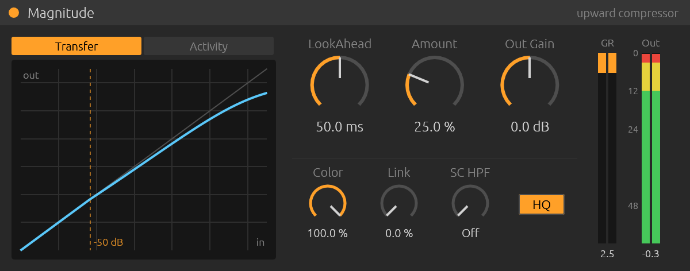

# Magnitude

[](LICENSE)
[](https://github.com/truce-audio/truce)
[](https://www.rust-lang.org/)
[]()
[](https://github.com/nagualcode/gersicpressurebornagain/releases)

> *"Pressure Mastering Compressor uses a technique called upward compression; it increases the level of quiet portions in a mix without reducing the level of attack transients like a traditional compressor."*
> — **Jeremy Gersic, 2006**

**Magnitude** is an upward mastering compressor for macOS (CLAP, VST3, AU). It is descended from the 2006 freeware VST **PRESSURE Upward Compressor** by Tom & Jeremy Gersic: the DSP was reverse engineered from the original SynthMaker schematic and rebuilt in Rust on the [Truce](https://github.com/truce-audio/truce) plugin framework. It reproduces the original sound by default, with fidelity fixes (see [What changed in v2](#what-changed-in-v2)) and optional modern features.

Until v2.0.1 the project was called **Gersic Pressure: Born Again**. See [Upgrading from Gersic Pressure](#upgrading-from-gersic-pressure).



Published under the vendor **Jardim Sonoro** in your DAW.

---

## Download (macOS, Apple Silicon)

Get the latest build from [Releases](https://github.com/nagualcode/gersicpressurebornagain/releases):

- `magnitude-<ver>-macos-arm64.pkg`: installer (CLAP, VST3, AU v2 + factory presets, user scope, no admin prompt).
- `magnitude-<ver>-macos-arm64-bundles.zip`: the raw `.clap`, `.vst3` and `.component` bundles.

The binaries are **arm64 only** (Apple Silicon). Intel Macs need to build from source.

The builds are ad-hoc signed and **not notarized**. If macOS blocks the installer, right-click → *Open*. If you use the zip, clear the quarantine flag before copying the bundles:

```bash
xattr -dr com.apple.quarantine "Magnitude.clap" "Magnitude.vst3" "Magnitude.component"
```

### Upgrading from Gersic Pressure

Magnitude keeps the same plugin identity as Gersic Pressure (CLAP/VST3 ids, the AU code `aufx PR3S Jrdm` and all parameter ids). Projects and presets saved with Gersic Pressure v1/v2 open in Magnitude unchanged, and the DAW simply shows the new name.

Because the identity is shared, **remove the old bundles** so your DAW doesn't find two plugins with the same id, then rescan:

```bash
rm -rf ~/Library/Audio/Plug-Ins/CLAP/"Gersic Pressure.clap" \
       ~/Library/Audio/Plug-Ins/VST3/"Gersic Pressure.vst3" \
       ~/Library/Audio/Plug-Ins/Components/"Gersic Pressure.component" \
       ~/Library/Audio/Presets/"Jardim Sonoro"/"Gersic Pressure"
```

(If you installed system-wide, the same names live under `/Library/Audio/Plug-Ins/`.)

---

## Controls

| Control | Range | Default | Origin | What it does |
| :--- | :--- | :--- | :--- | :--- |
| **LookAhead** | 0–100 ms | 50 ms | 2006 | Delays the audio relative to the detector. Changes glide without clicks, and the latency is reported to the host for delay compensation. |
| **Amount** | 0–100 % | 25 % | 2006 | Blend of the compressed path into the dry path. |
| **Out Gain** | ±50 dB | 0 dB | 2006 | Gain before the soft saturator. |
| **Color** | 0–100 % | 100 % | v2 | Saturator drive. 100 % is the original `x / (1 + |x|)`, 0 % is fully clean. |
| **Link** | 0–100 % | 0 % | v2 | Stereo detector link. 0 % detects each channel on its own, like the original. |
| **SC HPF** | Off, 20–500 Hz | Off | v2 | High-pass on the detector only, so bass stops driving the compression. |
| **HQ** | on/off | on | v2 | Runs the saturator 4× oversampled with linear-phase filters. Adds 71 samples of latency, which the host compensates. |

The editor follows the layout of an Ableton Live device. Drag a dial up or down to change it, hold Shift or Cmd for fine steps, and double-click to reset. The display has two views: **Transfer** shows the live static curve with the detector level as a dot, and **Activity** shows about 4 s of detector level and gain-reduction history. The meters show the gain reduction you actually hear after the blend, per channel, plus the output peak.

---

## How it works

Upward compression is done the way the original does it, with a parallel blend. A copy of the signal is compressed above −50 dBFS and mixed back with the dry signal. Loud passages are pulled down in the wet path while quiet ones pass at unity, so after the blend the quiet material sits relatively higher. The dry path stays a clean copy of the input, so transients are kept.

```
in ─┬──────────────────────────────── lookahead delay ── dry ──┐
    │                                                          ▼
    └─ [SC HPF] ─ |x| ─ [link] ─ envelope ─ gain computer ─ g ─► dry·(1 − a + a·g) ─ out gain ─ soft clip ─ out
```

| Stage | Equation (from the schematic) |
| :--- | :--- |
| Detector | `in = |x| + 1e-8`; `c = in >= env ? c_att : c_rel`; `env = c·(env − in) + in − 1e-8` |
| Ballistics | `c = 0.01^(1 / (t·fs))` with `t_att = 0.2 ms`, `t_rel = 250 ms` (time to fall to 1 %) |
| Gain computer | `GR_dB = −max(env_dB + 50, 0) · (1 − 0.5994)` |
| Blend | `dry·(1 − Amount) + dry·g·Amount` |
| Saturator | `y = x / (1 + clip·|x|)`, with `clip = 1.0` in the original |

### Reverse engineering

The original `Gersic_Pressure.dll` was unpacked from UPX, and its OutSim SynthMaker 0.9.5 payload was decrypted (4-byte rotation `[2, 4, 5, 3]`) to recover `schematic.osm`. The code components (envelope follower, transfer function, delay, soft clipper) are stored there as plain text. The parameter values come from the binary parameter block: `Threshold = -50.0`, `Attack = 0.0002`, `Release = 0.25`, `Ratio = 0.5994`, `softclip = 1.0`.

---

## What changed in v2

### Fidelity fixes (v1 did not match the original)

1. **Envelope ballistics.** SynthMaker's `co_eff_calc` defines a time as *time to decay to 1 %*. The schematic even caches the coefficients it computed at 44.1 kHz (0.593257 and 0.999582), and those match `0.01^(1/(t·fs))` exactly. v1 used `exp(−1/(t·fs))`, which made the release about 4.6× slower than the original. Measured recovery from 20 dB to 3 dB of GR: **v1 1220 ms → v2 266 ms**.
2. **Stereo detection.** The original runs its compressor on SSE lanes and has separate `reduction1` / `reduction3` outputs, which points to independent per-channel detection. v1 always linked the channels with `max(|L|, |R|)`. v2 defaults to unlinked, and **Link** brings back the v1 behaviour.
3. **Parameter smoothing.** v1 called the smoother once per *block*, but Truce's `read()` advances it by one *sample*. Amount and gain moved in block-sized steps, and a "10 ms" smoother took about 10 blocks. v2 smooths every sample.
4. **Latency.** v1 delayed the audio by the lookahead (50 ms by default) without telling the host, so the track played late against the rest of the session. v2 reports its latency, and it changes with LookAhead and HQ.
5. **Lookahead changes.** v1 jumped between whole-sample delays and clicked when you moved the knob. v2 glides with Hermite interpolation and snaps to the exact sample when it settles.

### Sound quality

- **Alias-free saturator.** At its original setting `x/(1+|x|)` is a strong nonlinearity, and at 1× it folds harmonics back into the audio band. With HQ on, a 7 kHz sine at 0 dBFS goes from **−29.7 dB of aliasing (v1) to −65.4 dB (v2)**. The oversampler is two Kaiser-windowed half-band FIR stages (127 + 31 taps, ~100 dB stopband) with integer latency.
- Gain computation runs every sample in the log2 domain. The original updated it every 64 samples (`hop(64)`), a 2006 CPU saving that stepped the gain.

### Performance

- The delay buffer is a power-of-two ring sized to the sample rate (64 KB at 48 kHz instead of a fixed 1.5 MB), so it fits in cache and wraps with a bit mask.
- One `log2` + `exp2` per channel, skipped completely below the threshold, plus one multiply for the blend.
- dB-to-linear for Out Gain only runs while the value moves. The FIR dot products are written so they vectorise with NEON.
- Measured on Apple Silicon, 60 s of stereo at 44.1 kHz: v1 2568× real time, v2 1928×, v2 with HQ 175× (about 0.6 % of one core).

Run the comparison yourself (the v1 DSP is kept verbatim in `examples/analyze/v1_dsp.rs`):

```bash
cargo run --release --example analyze
```

---

## Validation

Every release is checked with `cargo truce validate`: **auval** (AU v2 and v3), **pluginval** (VST3) and **clap-validator 0.4.1** (CLAP: 37 passed, 7 skipped for extensions the plugin doesn't implement).

clap-validator found two spec violations in Truce 6.3.0's CLAP wrapper: `clap_host_latency::changed` was called while the plugin was active, and state/preset loads didn't request a parameter rescan. They are fixed in a vendored copy (`vendor/truce-clap`, see `PATCHED.md`) that the build uses through `[patch.crates-io]`. The fixes are proposed upstream in [truce-audio/truce#238](https://github.com/truce-audio/truce/pull/238); the vendored copy goes away once they ship.

---

## Factory presets

All 10 original presets are included. They contain only the three original controls, so they load with the v2 extras at their defaults (Color 100 %, Link 0 %, SC HPF off), which is the original sound.

| Preset | LookAhead | Amount | Out Gain |
| :--- | :--- | :--- | :--- |
| Default | 50.0 ms | 25.0 % | 0.0 dB |
| Very Light Compression | 0.0 ms | 12.5 % | 0.0 dB |
| Light Compression | 0.0 ms | 26.25 % | 0.0 dB |
| Medium Compression | 0.0 ms | 50.0 % | 0.0 dB |
| Heavy Compression | 0.0 ms | 73.75 % | 0.0 dB |
| Squashed | 0.0 ms | 100.0 % | 0.0 dB |
| Look at that! | 68.75 ms | 50.0 % | 0.0 dB |
| Buk a Chuck a | 70.0 ms | 72.5 % | 0.0 dB |
| Number Nine Number Nine | 50.0 ms | 33.0 % | 0.0 dB |
| All the way up | 0.0 ms | 8.75 % | 0.0 dB |

Parameter IDs are hashes of the field names, and the three original fields kept their names, so v1 projects and presets load unchanged in v2.

> **Note on the saturator:** at Color 100 % (the original) the output is always shaped. A 0 dBFS peak comes out at −6 dBFS and −20 dBFS is about 0.8 dB quieter. That is the 2006 character. Lower **Color** for a cleaner output.

---

## Building from source

Requirements: [Rust](https://rustup.rs/) 1.92+ and the Truce CLI (`cargo install cargo-truce`).

```bash
git clone https://github.com/nagualcode/gersicpressurebornagain.git magnitude
cd magnitude

cargo truce install --clap --vst3 --au2 --user    # build + install into your user plugin folders
cargo truce run                                   # standalone, no DAW needed
cargo test --release                              # DSP, real-time-safety, preset and GUI snapshot tests
cargo truce package --formats clap,vst3,au2 --user --host-only   # .pkg installer in target/dist
```

## Project structure

```
├── src/
│   ├── lib.rs            # parameters, block processing, meters, latency
│   ├── dsp.rs            # detector, gain computer, lookahead, saturator
│   ├── oversampling.rs   # 4x linear-phase half-band oversampler
│   ├── editor.rs         # egui editor (Live-style device)
│   └── main.rs           # standalone runner
├── examples/analyze/     # v1 vs v2 measurements (release, aliasing, CPU)
├── presets/              # 10 original factory presets
├── tests/presets.rs      # preset integrity tests
├── screenshots/          # GUI snapshot baseline
├── assets/               # plugin icons
├── vendor/truce-clap/    # Truce CLAP wrapper with two spec fixes (see PATCHED.md)
└── legacy/               # original 2006 artifacts (DLL, schematic, manual)
```

## Credits & license

- **Original algorithm & concept (PRESSURE, 2006):** Tom & Jeremy Gersic. Magnitude is an independent project and is not affiliated with or endorsed by them.
- **Magnitude (reverse engineering, DSP, Rust implementation):** [nagualcode](https://github.com/nagualcode) (2026).
- **Vendor:** Jardim Sonoro.
- Magnitude's source code is released under the [MIT License](LICENSE). The files in `legacy/` are the original authors' work and are included for research and reference only.
